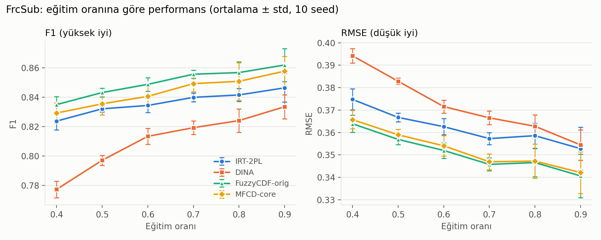
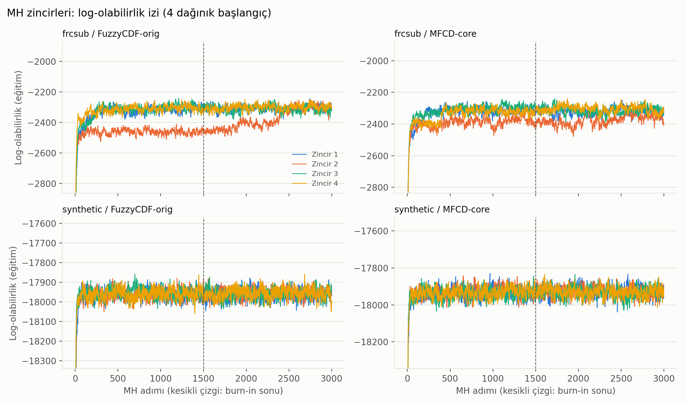

# Fuzzy Cognitive Diagnosis (MFCD-core)

Bulanık Mantık dersi dönem projesi: bir makalenin bulanık bilişsel tanı çekirdeğinin yeniden gerçekleştirilmesi ve özgün katkı.

> **Durum:** Tüm deneyler tamamlandı. Teknik rapor: [report/report.pdf](report/report.pdf) (tabloları `python3 -m report.build_report` CSV'lerden üretir).

## Student Information
- **Ad Soyad:** Musa Semih Büyüközkan
- **Öğrenci No:** 1306230099
- **Ders:** Bulanık Mantık (2026-2027 Güz)

## Original Paper
Y. Zhang and Y. Wang, "A personalized recommendation algorithm for English exercises incorporating fuzzy cognitive models and multiple attention mechanisms," *Scientific Reports*, vol. 15, art. 11531, 2025. DOI: [10.1038/s41598-025-96489-3](https://doi.org/10.1038/s41598-025-96489-3)

## Problem Description
Bir öğrencinin henüz çözmediği bir alıştırmadaki başarısını, geçmiş cevaplarından tahmin etmek. Öğrencinin her bilgi noktasındaki yeterliliği kesin (var/yok) değil, 0 ile 1 arasında bir **üyelik derecesi** olarak modellenir.

## Method
Makalenin MFCD (geliştirilmiş fuzzy cognitive diagnosis) bileşeni: sigmoid üyelik fonksiyonu, objektif sorularda bulanık VE (t-norm), subjektif sorularda bulanık VEYA (t-conorm), bilgi açığı, slip/guess parametreleri ve Metropolis-Hastings ile parametre kestirimi. Dikkat tabanlı MAKT bileşeni **bilinçli olarak kapsam dışıdır**.

## Fuzzy System Architecture
Her öğrenci-soru çifti için akış (ayrıntı: [src/mfcd.py](src/mfcd.py)):

```
θ_i, α_k, β_k --(sigmoid üyelik, Eş.1)--> a_ik  (öğrencinin beceri k'daki yeterlilik derecesi)
a_ik, μ_jk    --(beceri katkısı)--------> ã_ijk
ã_ijk         --(bulanık VE: objektif / VEYA: subjektif)--> η_ij
η_ij, s_j, g_j --(slip / guess)---------> P(r_ij = 1) = (1-s_j) η_ij + g_j (1-η_ij)
```
- **Bulanık küme / üyelik:** "beceri k'yı bilenler" kümesinde öğrencinin üyelik derecesi 0-1 arasındadır.
- **VE (t-norm):** objektif sorular tüm gerekli becerileri ister. Gödel: min, çarpım: a·b, Łukasiewicz: max(0, a+b-1).
- **VEYA (t-conorm):** subjektif sorularda bir beceri diğerini telafi edebilir. Gödel: max, olasılıksal toplam: a+b-ab, Łukasiewicz: min(1, a+b).
- **Bilgi açığı:** objektif soruda `ã = 1 - μ(1 - a)`; Gödel ile birleşince makaledeki Eş. 8-9 elde edilir.
- Zaman ve cevap süresi, gözlemlerin olabilirlik ağırlığı olarak kullanılır.

## Dataset
- **FrcSub** (gerçek veri, kesir çıkarma): indirme betiği ile alınır, repoya konmaz.
- **Sentetik veri**: makalenin yapısını taklit eder; açıkça sentetik olarak raporlanır.

Ayrıntı: [data/README.md](data/README.md)

## Installation
```bash
git clone https://github.com/semihbuyukozkan/fuzzy-cognitive-diagnosis.git
cd fuzzy-cognitive-diagnosis
pip install -r requirements.txt
```

## Requirements
Python 3.10 (3.13'te sabitlenmiş numpy/scipy sürümleri derlenmez), bağımlılıklar [requirements.txt](requirements.txt) dosyasında. İsteğe bağlı: `bsdtar` (FrcSub RAR arşivi için; macOS'te hazır gelir) ve rapor PDF'i için Google Chrome.

## How to Run
**Canlı demo** (tek öğrenci/soru için fuzzification → kural → slip/guess → durulaştırma zinciri, ~5 sn):
`python3 -m demo.canli_demo --ogrenci 12 --soru 5 --theta 2.0` (`--operator product` ile VE operatörü değiştirilebilir).

Testler: `python3 -m pytest -q`. Deney komutları [Reproduction Experiments](#reproduction-experiments) bölümünde.

## Reproduction Experiments
**E1: FrcSub üzerinde karşılaştırma** (10 seed, ortalama ± std; ayrıntılı yorum: [docs/report_notes.md](docs/report_notes.md))

```bash
python3 -m src.data_frcsub                 # veriyi indir ve doğrula
python3 -m experiments.baseline.e1_frcsub  # 240 koşu (~7 dk, 10 süreç)
python3 -m experiments.baseline.plot_e1    # grafik
python3 -m experiments.baseline.e1_table   # tablo
python3 -m experiments.proposed.mcmc_convergence   # yakınsama kanıtı (4 zincir, R-hat, iz grafiği)
```

FrcSub'da iki MH modeli (FuzzyCDF-orig, MFCD-core) 3 farklı başlangıçla çalıştırılır ve eğitim olabilirliği en
yüksek zincir seçilir Gerekçe: MH zincirleri bu veride bazen kötü bir yerel
çukura düşüyor (aşağıda "MCMC convergence").

| Eğitim oranı | Model | PRE | Recall | F1 | MAE | RMSE |
|---|---|---|---|---|---|---|
| 50% | IRT-2PL | 0.814 ± 0.006 | 0.852 ± 0.007 | 0.832 ± 0.002 | 0.242 ± 0.001 | 0.367 ± 0.002 |
| 50% | DINA | 0.844 ± 0.005 | 0.755 ± 0.004 | 0.797 ± 0.003 | 0.302 ± 0.002 | 0.383 ± 0.001 |
| 50% | FuzzyCDF-orig | 0.819 ± 0.005 | 0.869 ± 0.005 | 0.843 ± 0.003 | 0.259 ± 0.002 | 0.357 ± 0.002 |
| 50% | MFCD-core | 0.823 ± 0.006 | 0.859 ± 0.006 | 0.841 ± 0.004 | 0.264 ± 0.002 | 0.357 ± 0.003 |
| 60% | IRT-2PL | 0.815 ± 0.007 | 0.855 ± 0.006 | 0.834 ± 0.005 | 0.241 ± 0.002 | 0.363 ± 0.004 |
| 60% | DINA | 0.850 ± 0.006 | 0.780 ± 0.010 | 0.813 ± 0.005 | 0.284 ± 0.003 | 0.372 ± 0.003 |
| 60% | FuzzyCDF-orig | 0.823 ± 0.005 | 0.877 ± 0.007 | 0.849 ± 0.004 | 0.252 ± 0.002 | 0.352 ± 0.003 |
| 60% | MFCD-core | 0.828 ± 0.005 | 0.864 ± 0.007 | 0.845 ± 0.004 | 0.254 ± 0.002 | 0.352 ± 0.003 |
| 70% | IRT-2PL | 0.816 ± 0.006 | 0.865 ± 0.007 | 0.840 ± 0.003 | 0.238 ± 0.002 | 0.357 ± 0.003 |
| 70% | DINA | 0.845 ± 0.005 | 0.795 ± 0.009 | 0.819 ± 0.005 | 0.272 ± 0.002 | 0.367 ± 0.003 |
| 70% | FuzzyCDF-orig | 0.827 ± 0.005 | 0.887 ± 0.006 | 0.856 ± 0.003 | 0.245 ± 0.001 | 0.346 ± 0.003 |
| 70% | MFCD-core | 0.830 ± 0.008 | 0.873 ± 0.010 | 0.851 ± 0.006 | 0.247 ± 0.002 | 0.346 ± 0.004 |



**Makale eğilimleriyle karşılaştırma (özet):** eğitim oranı arttıkça iyileşme ve F1'de DINA < FuzzyCDF eğilimi
**uyuşuyor**. PRE'de DINA'nın makaledeki gibi en düşük olması **uyuşmuyor** (bizde en yüksek). Dereceli μ'nün eklendiği
MFCD-core, FrcSub'da FuzzyCDF-orig'i geçmiyor: F1'de küçük ama tutarlı geride (-0.003...-0.005), RMSE'de fark yok.
Nedenleri ve sınırları [docs/report_notes.md](docs/report_notes.md) içinde tartışılmıştır.

**MCMC convergence:** Sentetik veride tahminler zincirler arasında tutarlı (log-olabilirlik R-hat ≈ 1.00, θ R-hat ≤ 1.03),
ancak α, β, slip, guess ve μ gibi bireysel parametrelerin bir kısmında R-hat > 1.1 (zayıf belirlenmişlik); bu parametreler
yorumlanmaz. FrcSub'da zincirlerin bir kısmı kötü bir yerel çukura düşüyor (özellikle MFCD-core). İz grafiği:


## Proposed Extension
Makalenin bulanık eklemelerinin etkisini ayrıştıran iki kontrollü deney (ayrıntı: rapor Bölüm 6 ve [docs/report_notes.md](docs/report_notes.md)):
- **K1 (ana katkı):** Bulanık operatör ailelerinin (Gödel, çarpım, Łukasiewicz) karşılaştırılması.
- **K2:** Zaman / süre / bilgi açığı faktörlerinin ablation'ı (yalnızca sentetik veri) ve **negatif kontrol** (zaman/süre cevaptan bağımsız).

```bash
python3 -m experiments.proposed.k1_operators && python3 -m experiments.proposed.plot_k1
python3 -m experiments.proposed.k2_ablation  && python3 -m experiments.proposed.plot_k2 && python3 -m experiments.proposed.plot_k2_kalibrasyon
python3 -m experiments.baseline.e4_sure      # süre ölçümü (tek işlem; ~10 dk)
python3 -m report.build_report               # rapor PDF'i
```

## Experimental Results
- **E1 (FrcSub):** yukarıdaki tablo. MFCD-core, FuzzyCDF-orig'i geçmedi (F1 ≈ -0.003); IRT-2PL ve DINA'dan iyi F1/RMSE.
- **K1:** FrcSub'da operatör ailesi pratikte fark etmedi (%60 F1: 0.849 / 0.848 / 0.847). Sentetikte Gödel > çarpım > Łukasiewicz, ancak veri Gödel ile üretildiği için bu beklenen bir sonuçtur. Grafik: `results/figures/k1_operators.png`.
- **K2:** "+süre" F1'i +0.053 artırıyor (0.618 → 0.671) fakat negatif kontrolde de +0.031 artırıyor; ortalama tahmin 0.481 → 0.580'e kayıyor (gerçek oran 0.481) ve **hiçbir faktör AUC'yi artırmıyor**. Yani F1 kazancı bir kalibrasyon yapaylığı. Grafikler: `results/figures/k2_ablation.png`, `results/figures/k2_kalibrasyon.png`.
- **E4 (süre, tek işlem, tek zincir, ortalama sn):** FrcSub: IRT-2PL 0.03, DINA 1.33, FuzzyCDF-orig 6.21, MFCD-core 7.11. Sentetik: IRT-2PL 0.11, DINA 5.86, FuzzyCDF-orig 54.35, MFCD-core 64.82. (`results/tables/e4_sure_summary.csv`)

Tüm sayılar `results/tables/` altındaki CSV dosyalarından gelir. Sentetik veri açıkça sentetiktir ve döngüsellik içerir (üreteç bu faktörlerle çalışır).

## Limitations
- Makale verisi kapalıdır; sayılar birebir karşılaştırılamaz, yalnızca eğilimler (bkz. [docs/paper_reference_results.md](docs/paper_reference_results.md)). MAKT (dikkat bileşeni) kapsam dışıdır.
- Zaman/süre ağırlıklarının uygulanışı ve Eş. 7 normalizasyonu bizim yorumumuzdur; makale belirsiz bırakmıştır ([docs/assumptions.md](docs/assumptions.md)).
- K1/K2 sentetik kısmı yalnızca %60 eğitim oranında koşuldu. FrcSub'da MFCD-core çok modludur; sentetikte bireysel α, β, μ yorumlanmaz.
- 10 seed; çok küçük farklar seed gürültüsüne yakındır.

## References
Bkz. [references/README.md](references/README.md).

## License
[MIT](LICENSE)
